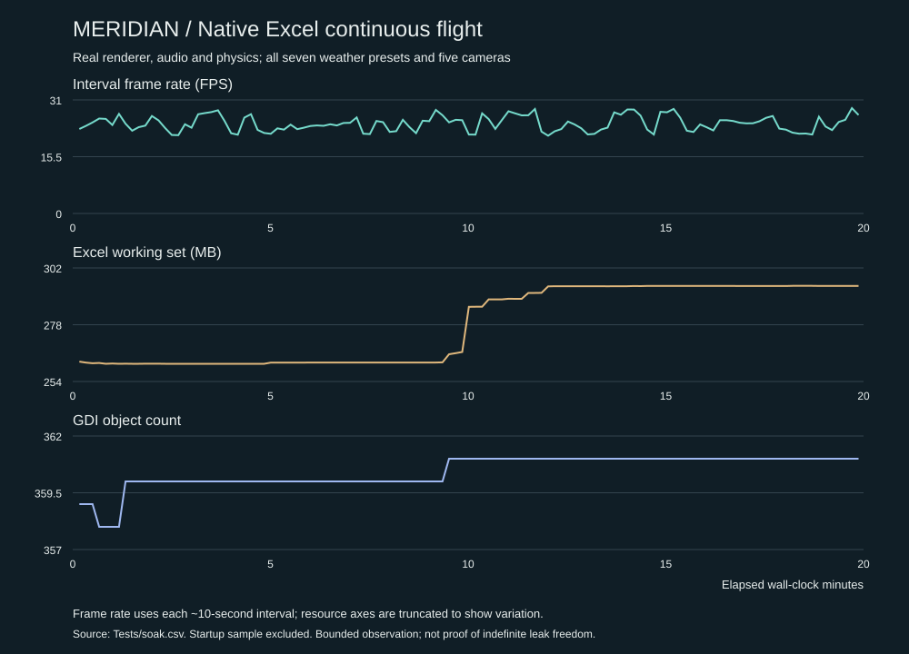

# v0.4 measurements

The final native run measured 15.44 FPS in Balanced, 18.98 FPS in Performance and 16.72 FPS with the moving map. A separate two-minute continuous flight with recording enabled averaged 21.33 FPS and captured 1,200 samples. See Tests/results.txt and Tests/soak-result.txt. The longer measurements below are from v0.3.

# Measured performance — v0.3

Measured on 2026-11-08 in native 64-bit Excel 16 / Office 2021 on Windows 11 Home 10.0.26100, Intel Core i7-8700K @ 3.70 GHz. Other applications were open. Results are local observations, not hardware-independent promises.

| Final native measurement | Result |
|---|---:|
| Balanced, 120 frames | 15.29 FPS |
| Balanced terrain / presentation preparation | 59.84 ms/frame |
| Balanced cockpit / overlay | 3.94 ms/frame |
| Performance, 120 frames | 22.82 FPS |
| Performance with moving map, 30 frames | 21.64 FPS |
| Continuous renderer/audio/physics | 1200.0 seconds; 29,433 frames |
| Continuous mean rate | 24.53 FPS |
| Excel working set, initial / peak | 253.8 / 294.5 MB |
| Working set over final five minutes | 294.36–294.45 MB |
| GDI objects, initial / peak | 359 / 361 |
| Audio buffers synthesized during continuous run | 12,003 |
| Separate three-launch cleanup check | 405 → 407 GDI objects |

The continuous run passed without a crash, invalid flight envelope or stalled audio refill. Working set increased by about 41 MB and then remained within 0.1 MB over the final five minutes. This is bounded evidence of a plateau, not a claim that every allocation is leak-free. Raw completion details are in `Tests/soak-result-v03.txt`; the final workbook test run is in `Tests/results.txt`.

## What the measurements cover

The 120-frame benchmark includes native terrain/cockpit generation, presentation to the UserForm, simulation advancement, and an event pump every ten frames. It is uncapped and excludes continuous audio mixing during that particular loop. The two preset loops follow successive flight positions; they are indicative workload comparisons rather than identical-view A/B samples.

The continuous diagnostic runs the real renderer, audio mixer, 60 Hz physics and automatic controller for 20 wall-clock minutes. It uses Performance, cycles weather every 45 seconds and all five camera modes, and records resource/state samples about every ten seconds. It deliberately ignores foreground focus, unlike the normal interactive loop. UI inspection and other desktop activity occurred during the run. Resource figures cover the whole Excel process, including Office caches. They do not isolate renderer allocations or prove indefinite leak freedom.

`Tests/manual-controls-v03.csv` records the separate physical UI check. `Tests/last-flight.csv` is overwritten on each interactive flight. `live-demo-pre-map-optimization.csv` and `live-flight.png` are historical v0.1/v0.2 artifacts, not v0.3 benchmark evidence. The older v0.2 renderer measured 16.14 FPS Balanced / 25.03 Performance before the depth/scenery additions.

## Optimizations and limits

- Preallocated typed frame/depth arrays and one resident terrain package avoid per-frame file I/O.
- Conservative near-ray skipping uses the measured terrain ceiling; distant rays take progressively larger steps.
- Performance fills two-column spans; Balanced samples every column.
- Prefiltered texture levels reduce distant aliasing; day/sunset terrain lighting and cloud opacity are cached.
- Static panel artwork, fonts and GDI bitmap/DC resources are reused. The attitude instrument uploads one bitmap.
- Scenery uses a small convex-polygon rasterizer and shares the terrain depth buffer; buildings are distance-culled.

Terrain generation remains the dominant cost. Performance is the default. Balanced falls back to Performance when measured FPS drops below 18; it does not oscillate upward during a flight. The production loop is capped around 30 FPS with a 60 Hz physics accumulator. A frame delay is capped at 200 ms to prevent unbounded catch-up; severe desktop stalls therefore lose simulated time instead of destabilizing integration. Balanced does not reach the original 20–30 FPS target on this machine.
