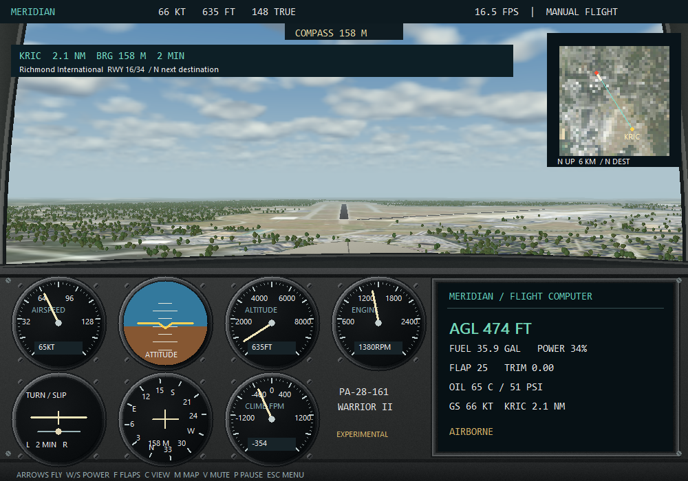

# MERIDIAN

**A real flight simulator inside Microsoft Excel.**

Native VBA flight physics, a full-resolution Windows OpenGL landscape and two software rendering modes, authentic USGS elevation and aerial imagery across the Richmond region (KFCI, KRIC and KOFP), a Piper Warrior-inspired aircraft, cockpit instruments, depth-tested airport buildings and a 3D aircraft, seven weather presets, and synthesized Windows audio.

All simulation and rendering decisions execute inside Excel. No external graphics engine, browser, Python runtime, or compiled custom DLL is needed to fly.

## Fly

Version 0.7 expands the world to an 81.92 km square, adding Richmond International (KRIC) and Hanover County (KOFP) to Richmond Executive (KFCI). It includes three connecting missions, a three-leg tour, destination navigation, a regional map, actual-airframe ground shadows and propeller animation. [Exploration guide](ExcelFlightSimulator/Documentation/EXPLORATION.md).

**[Download Meridian v0.7](https://github.com/thethriftypilot/meridian-excel-flight-simulator/releases/tag/v0.7.0)** and select **Detailed 3D** for the full-resolution landscape, textured woodland, detailed aircraft and higher-resolution airport imagery. Choose **Detailed 3D / 2x** to render at 2000 × 1400 for smoother edges. Extract the ZIP into a new folder to keep the debriefs and personal bests in your existing workbook.

**New in v0.4:** scored runway 15 and crosswind landing challenges, Excel debriefs with flight-path/altitude charts, local personal bests, and five-camera replay with pause, seek and playback speed. [Challenge and replay guide](ExcelFlightSimulator/Documentation/CHALLENGES.md).

Visit [Meridian on The Thrifty Pilot](https://www.thethriftypilot.com/meridian) for screenshots, requirements and setup instructions, or browse the [Pilot Tools directory](https://www.thethriftypilot.com/aviation-software).

Download the complete package from [Releases](https://github.com/thethriftypilot/meridian-excel-flight-simulator/releases), extract it, and open `ExcelFlightSimulator.xlsm` in 64-bit Windows desktop Excel. Keep the Assets folder beside it. Authorize macros for this file through your normal trusted-file process, then choose **OPEN FLIGHT SIMULATOR** → **START FLIGHT** or **WATCH DEMONSTRATION**.

[Pilot guide](ExcelFlightSimulator/Documentation/README.md) · [Controls](ExcelFlightSimulator/Documentation/CONTROLS.md) · [Architecture](ExcelFlightSimulator/Documentation/ARCHITECTURE.md) · [Measured performance](ExcelFlightSimulator/Documentation/PERFORMANCE.md) · [Verification](ExcelFlightSimulator/Documentation/TESTING.md) · [Delivery audit](ExcelFlightSimulator/Documentation/REQUIREMENTS.md)

## Development

The source lives in `ExcelFlightSimulator/Source/VBA`. Build with `ExcelFlightSimulator/Tools/Build/build.ps1 -Test` on a Windows machine with installed Excel and authorized VBA project access. [Full build instructions](ExcelFlightSimulator/Documentation/BUILD_INSTRUCTIONS.md).

Large terrain binaries and generated workbooks are distributed in releases rather than Git history. Reproduce terrain from the retained public service URLs using the Python preprocessing tool, or obtain it from a release package. [Source attribution and rights](ExcelFlightSimulator/Documentation/TERRAIN_SOURCES.md).

This is experimental entertainment software. It is not a certified flight model, training device, or navigation source. [Known limitations](ExcelFlightSimulator/Documentation/KNOWN_LIMITATIONS.md) distinguish implemented systems from outstanding work.

GitHub Actions checks Python and PowerShell tooling syntax and rejects VBA calls accidentally written as procedure-name labels. Native VBA verification requires desktop Excel and is recorded in the release package; CI does not claim to run Excel.
